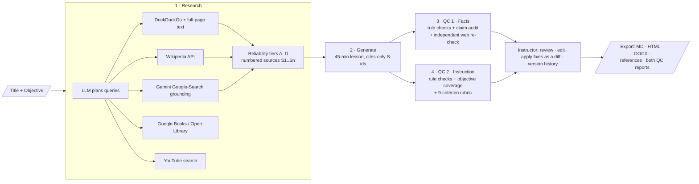

<div align="center">

# 📘 AI Lesson Creation Tool

**Lesson title + learning objective in → a researched, cited, 45-minute lesson out, checked by two independent Quality-Control layers.**


-F55036)

[](https://github.com/Nakulraj-23/Kalvium_lesson_creation/actions/workflows/tests.yml)


[**▶ Demo video**](DEMO_VIDEO_LINK) · [Sample: HTTP lesson](samples/http-requests-and-responses/lesson.md) · [Sample: SQL lesson](samples/sql-joins/lesson.md) · [Fact-check log](docs/FACT_CHECK.md)

</div>

---

## Results at a glance

Both test lessons were generated end-to-end by the tool, improved using its own QC recommendations, fact-checked by hand, and then re-audited.

| Test lesson | Research found | QC 1 · Facts<br>v1 → after fixes → final | QC 2 · Instruction<br>v1 → after fixes → final | Outputs |
|---|---|---|---|---|
| **HTTP Requests and Responses** *(required sample)* | 9 web sources · 2 books · 10 videos | 71 → 85 → *(pending)* | 79 → 79 → *(pending)* | [lesson](samples/http-requests-and-responses/lesson.md) · [QC1](samples/http-requests-and-responses/qc1_factual_report.md) · [QC2](samples/http-requests-and-responses/qc2_instructional_report.md) · [HTML](samples/http-requests-and-responses/lesson.html) · [DOCX](samples/http-requests-and-responses/lesson.docx) |
| **SQL Joins** *(my second test)* | 10 web sources · 5 books · 8 videos | 49 → 74 → *(pending)* | 78 → 73 → *(pending)* | [lesson](samples/sql-joins/lesson.md) · [QC1](samples/sql-joins/qc1_factual_report.md) · [QC2](samples/sql-joins/qc2_instructional_report.md) · [HTML](samples/sql-joins/lesson.html) · [DOCX](samples/sql-joins/lesson.docx) |

**Manual fact-check:** I checked 20 claims and items against RFC 9110 and the PostgreSQL/MySQL docs, and 12 were fully correct. The QC layers caught 5 of the 8 problems: a contradicted quiz answer and a 49-minute lesson outright, and two incorrect HTTP examples partly. They missed an outdated RFC reference, a misleading performance claim and a missing pitfall, all of which I corrected as instructor edits. Full table: [`docs/FACT_CHECK.md`](docs/FACT_CHECK.md).

---

## How it works



Every step is saved on its own. A failed step records its error and gets a **Retry** button, and it never overwrites earlier work.

---

## Requirement coverage

| Requirement in the brief | How it's met |
|---|---|
| **Inputs:** lesson title + learning objective | The create screen validates both: empty, too short and too long inputs are rejected with clear messages |
| **Research:** books, websites, YouTube | Websites: DuckDuckGo search with full-page extraction (trafilatura), Wikipedia API and Gemini Google-Search grounding. Books: Google Books with Open Library as fallback. Videos: YouTube Data API, or yt-dlp search with no key. Each source fails independently |
| **Structured, engaging lesson** with explanations, examples, practical application | Hook → concepts → worked examples → hands-on activity → knowledge check with answer key → summary. Every section maps to measurable sub-objectives |
| **Designed for 45 minutes** | Each section has allotted minutes that must sum to 45. QC2 checks reading time per section (180 wpm). QC revisions are rebalanced back to 45 automatically |
| **YouTube videos as supplementary resources** | 2–3 videos chosen **only from real search results** (videos over 25 minutes are excluded). They're embedded in the preview and HTML export |
| **Reference links at the end** | Built **by code** from the sources actually cited. Inline `[S3]` citations become numbered references |
| **QC 1:** factual accuracy, source reliability, gaps | Claim-by-claim audit against source excerpts. Doubtful claims are re-checked with Google Search. Code flags fake citation IDs, made-up URLs and broken links, and tiers each source's reliability |
| **QC 2:** objective alignment, clarity, structure, gaps | An independent breakdown of the objective with a taught / practised / assessed map, a 9-criterion rubric, and code checks for timing, required sections and untested sub-objectives |
| **Separate audit reports** with issues + suggestions | Two reports with a score, severity-ranked issues (evidence + suggested fix) and claim table / rubric, exported as Markdown + JSON |
| **Review, edit, save** | Edit every section (title, minutes, type, objectives, markdown), add or delete sections. Every save becomes a version, and any version can be restored |
| **Review & apply QC recommendations** | Tick issues → the AI drafts revised sections → **diff** → Accept (new version) or Reject (no change) |
| **Preview + export** | Rendered preview with embedded videos. ZIP containing `lesson.md`, `.html`, `.docx`, `references.md`, both QC reports (`.md` + `.json`) and the raw research |
| **Error handling** | Empty-input validation. Every AI call has a hard timeout and falls back across models when one is busy, rate-limited, too small for the request or retired. Malformed JSON gets an automatic repair attempt. Writes are atomic. Failed steps keep all saved work and can be retried |

---

## Quick start

```bash
git clone https://github.com/Nakulraj-23/Kalvium_lesson_creation.git
cd Kalvium_lesson_creation
python -m venv .venv && source .venv/bin/activate     # Windows: .venv\Scripts\activate
pip install -r requirements.txt
cp .env.example .env                                   # then add GROQ_API_KEY (free: console.groq.com/keys)
streamlit run app.py                                   # opens http://localhost:8501
```

* **Keys:** `GROQ_API_KEY` is required and free. `GEMINI_API_KEY` is optional and adds Google-Search grounding.
* **macOS one-click:** `bash START_HERE.command` installs Python 3.12 (via uv), asks for the key, runs the tests and both sample lessons, then opens the app.
* **Reproduce the samples:** `python run_samples.py`, then `python finalize_samples.py`.
* **Tests (offline, no keys):** `python -m pytest -q`

---

## Key technical decisions

1. **The model cannot make up sources.** Code assigns IDs (`S#` web, `B#` books, `V#` videos) to real retrieved items, and the model may only cite those IDs. Unknown IDs are dropped or flagged high-severity, and the reference list and every link come from the research data.
2. **Evidence-first generation.** The writer sees relevance-filtered excerpts of each page, not just titles, so QC1 has real text to check each claim against.
3. **Two genuinely independent QC layers.** Each has a separate prompt, system role ("you did not write this lesson") and temperature, and neither sees the other's report. QC also starts on a **different model** from the writer (e.g. GPT-OSS-120B writes, another model audits).
4. **Rules + LLM in each layer.** Code handles what code does reliably, such as fake citation IDs, made-up URLs, broken links, minutes not adding to 45, a missing activity or quiz, and untested sub-objectives. The LLM judges misleading claims, clarity and alignment. Each issue is labelled *rule check*, *AI audit* or *web verification*.
5. **"Unsupported" is not the same as "wrong".** A claim missing from our sources may still be true, so doubtful claims are re-checked with a separate Google-Search-grounded call. FALSE becomes a high-severity factual error, while TRUE-but-uncited becomes a low-severity "add a citation".
6. **Transparent reliability tiers.** Domains are grouped as A (standards, official docs, .gov/.edu), B (reputable reference), C (general web) and D (user-generated, excluded). Higher tiers are put in front of the model first.
7. **The instructor stays in control.** QC fixes are proposals shown as diffs, nothing is saved without Accept, and every version can be restored.
8. **Resilient to free-tier limits.** Models are discovered from the provider's model list. On 429 it waits for retry-after or switches model, on 413 (request too large) it moves to a model with a bigger limit, and on 5xx or a timeout it moves to the next model. Prompts are sized to fit per-minute token limits.
9. **Why I moved from Gemini-only to Groq.** In testing, Gemini's free tier often returned 503 "high demand", 504 timeouts and retired model names. Groq was faster and more reliable, so it became the default. Gemini is kept for Google-Search grounding, where it's genuinely better, and the provider can be switched with one line in `.env`.

**Scoring.** QC1 = 60% × claim-support rate + 40% × (100 − issue penalties). QC2 = 70% × rubric average + 30% × (100 − penalties). Penalties are high 12, medium 6, low 2.

---

## Project structure

```
├── app.py                     Streamlit UI: create · research · edit · QC 1 · QC 2 · preview · export · history
├── lesson_tool/
│   ├── pipeline.py            step runner: status, prerequisites, retry, never overwrites on failure
│   ├── research/              query planning, providers (web, Wikipedia, books, YouTube), reliability tiers
│   ├── generator.py           lesson generation, citation normalisation, timing metrics
│   ├── qc.py                  QC 1 (facts) and QC 2 (instruction): rule checks + LLM audits + scoring
│   ├── apply.py               apply selected QC recommendations → revised sections + diff
│   ├── export.py              Markdown / HTML / DOCX / ZIP, reference list built by code
│   ├── groq_llm.py            Groq backend: model discovery, rate-limit-aware fallback, JSON mode
│   ├── llm.py                 Gemini backend (grounding), provider selection, robust JSON parsing
│   ├── prompts.py             every prompt in one place
│   ├── models.py · storage.py pydantic models · atomic JSON storage with versions
├── samples/                   real outputs for both test lessons (lesson, references, QC reports)
├── docs/FACT_CHECK.md         ground-truth facts + manual verification log
├── docs/DEMO_SCRIPT.md        demo walkthrough
├── tests/                     30 offline tests (fake LLM + fake providers + Streamlit AppTest)
├── run_samples.py · finalize_samples.py · START_HERE.command
```

## Testing
`python -m pytest -q` runs 30 offline tests, also run by GitHub Actions on every push. They cover the full pipeline, every QC rule (fake citation, made-up URL, broken link, FALSE claim, timing), failure preservation and retry, total research failure, apply-and-diff, export contents including DOCX, storage corruption, and both AI backends' fallback behaviour (busy, timeout, retired model, rate limit, request too large, bad key, malformed JSON). Streamlit UI flows are tested with `AppTest`.

## Limitations and next steps
* Search results vary between runs, so lessons and scores vary too.
* On the free tier, the strongest model's daily limit and Gemini's grounding quota can run out, and QC quality drops when that happens. The report records it ("web verification step failed").
* AI-assisted QC reduces risk but doesn't replace a subject-matter expert. My own check found issues both layers missed (see the fact-check log).
* Next steps: video relevance from transcripts, a dedicated claim-verification model, a multi-reviewer workflow and SCORM/LMS export.

## Acknowledgements
Groq API (GPT-OSS, Llama, Qwen open-weight models), Google Gemini API and the `google-genai` SDK, Streamlit, Pydantic, `ddgs` (DuckDuckGo search), trafilatura, yt-dlp, the Wikipedia, Google Books and Open Library APIs, Python-Markdown, python-docx, json-repair and pytest. Facts were verified against IETF RFC 9110 / RFC 6585 and the PostgreSQL, SQLite and MySQL documentation.
**AI assistance:** I used AI coding assistants to help write and debug the code, as the brief allows. I directed the design, ran and fact-checked the outputs, and can explain every part of the implementation.
